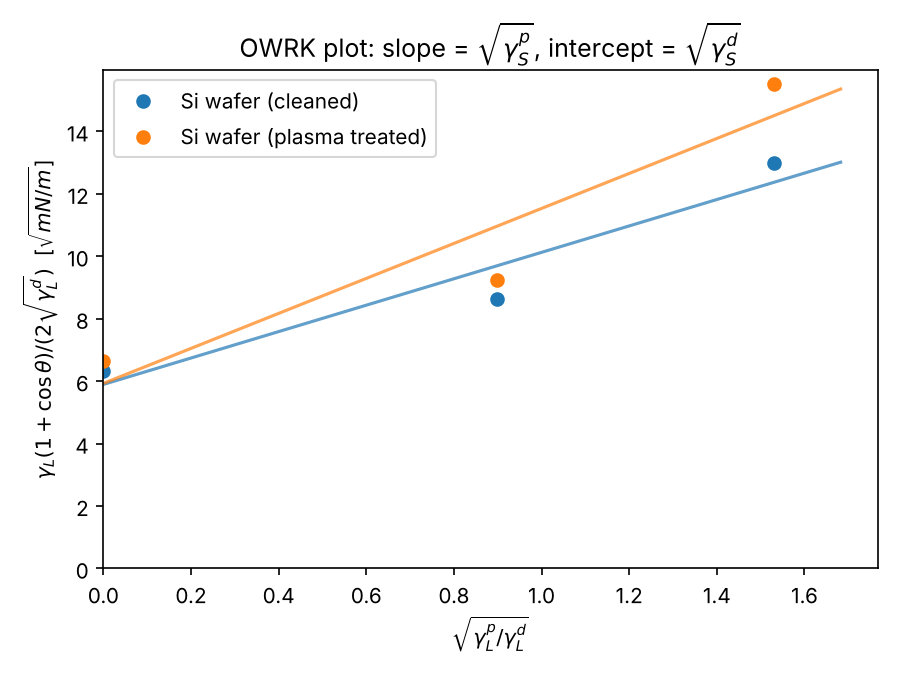

# Surface free energy from contact angles (OWRK)

A small Python tool that calculates the surface free energy of a solid, split into its **dispersive** and **polar** parts, from sessile drop contact angles of two or more test liquids. It uses the Owens, Wendt, Rabel and Kaelble (OWRK) method.

I built it to evaluate contact angle measurements like the ones from my lab course on surface wetting (KRÜSS drop shape analyser), where we compared clean and plasma treated silicon.

## Method

For each test liquid L on the solid S:

$$\frac{\gamma_L (1+\cos\theta)}{2\sqrt{\gamma_L^d}} = \sqrt{\gamma_S^p}\,\sqrt{\frac{\gamma_L^p}{\gamma_L^d}} + \sqrt{\gamma_S^d}$$

Plotting the left side (y) against $\sqrt{\gamma_L^p/\gamma_L^d}$ (x) gives a straight line:

- slope = $\sqrt{\gamma_S^p}$ → polar part
- intercept = $\sqrt{\gamma_S^d}$ → dispersive part
- total surface energy $\gamma_S = \gamma_S^d + \gamma_S^p$

The script averages repeated drops, fits the line for every sample and reports R² as a quick check of the fit.

Built in test liquids (mN/m, 20 °C): water, diiodomethane, ethylene glycol, formamide, glycerol.

## Usage

```bash
pip install -r requirements.txt
python owrk.py examples/example_angles.csv --plot examples/owrk_plot.png
```

Input CSV (one row per drop):

```csv
sample,liquid,angle_deg
Si wafer (cleaned),water,48.2
Si wafer (cleaned),diiodomethane,38.5
Si wafer (cleaned),ethylene glycol,30.1
```

## Example output

```
Surface free energy (OWRK):
                   sample  total_mN_m  dispersive_mN_m  polar_mN_m  polar_fraction_%   R2
       Si wafer (cleaned)       52.63            34.72       17.91             34.02 0.93
Si wafer (plasma treated)       66.53            35.12       31.41             47.21 0.89
```



Plasma treatment mainly raises the **polar** part, because it removes organic contamination and creates polar hydroxyl groups on the silicon surface. The dispersive part stays almost the same.

*The angles in `examples/example_angles.csv` are illustrative values for demonstration, not raw lab data.*

## Ideas for next steps

- Add more methods (Wu, Fowkes, Zisman)
- Error propagation from the standard deviation of the angles
- Read export files from drop shape analysers directly
